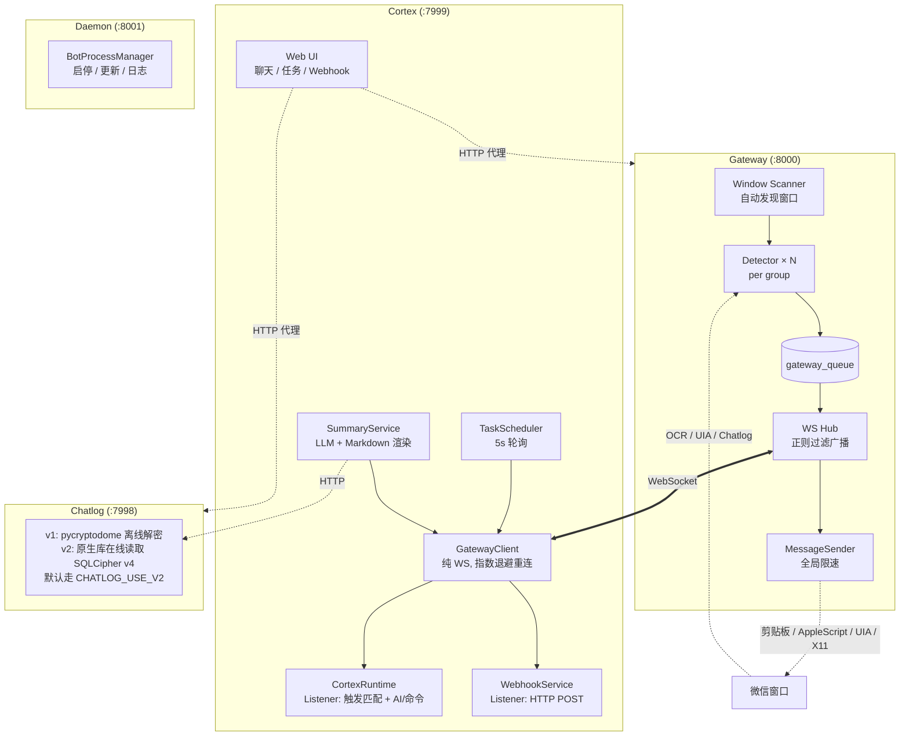

# AWSL 微信机器人

> **免责声明：本项目仅供学习交流，请勿用于商业或违规用途。使用本项目产生的任何后果由使用者自行承担。**

跨平台微信群聊机器人，采用 Gateway + Chatlog + Cortex 微服务架构。Gateway 通过 Quartz/UIAutomation/Chatlog+X11 与微信窗口交互，以 WebSocket 协议广播消息；Chatlog 作为独立数据层服务提供微信数据库解密/查询；Cortex 作为 WS 客户端，通过 MessageListener 模式处理 AI 回复、群聊总结、动态命令、定时任务和 Webhook 转发。

## 功能特性

- **跨平台支持**：macOS (Quartz 截图 + Vision OCR) / Windows (UIA / Chatlog 读取) / Linux (Chatlog / AT-SPI 读取 + X11 发送)
- **自动窗口发现**：自动扫描微信群聊窗口，动态增删检测线程
- **WebSocket 消息网关**：统一消息广播，支持正则过滤订阅
- **多群并发处理**：每群独立检测线程，全局限速发送
- **内置 Web UI**：访问 Cortex `:7999/` 即可发送文本/图片/文件/语音，并管理定时任务、命令和 Webhook
- **Chatlog 双后端**：v1（pycryptodome 离线解密）/ v2（原生库在线读 SQLCipher v4，Windows/Linux），默认走 v2
- **富媒体渲染**：图片（V2 .dat 派生 AES + wxgf→JPEG）/ 表情包 / 语音（SILK→MP3）/ 视频缩略图 / 位置 / 名片 / appmsg；Web UI 内置 `[发呆][呲牙]` 等微信表情符 → Unicode emoji 替换
- **定时任务 / 群聊总结 / @触发 / 动态命令 / Webhook 转发**

## 消息读取方式（Windows / Linux）

通过 `.env` 或环境变量配置消息读取方式，修改后重启 Gateway 生效：`LINUX_MESSAGE_READER=chatlog`（默认）、`WINDOWS_MESSAGE_READER=accessibility`（默认 UIA）。两项均可选 `chatlog` / `accessibility`，Linux 的辅助功能为 AT-SPI。读取选择和处理均在各平台适配器内部实现。

Chatlog 需要 v2 服务，可提供发送人及 @ 信息。Linux AT-SPI 只读取独立窗口已加载的文本，不依赖 Chatlog；当前控件不提供发送人及 @，只能过滤程序自己发送的文本/文件，无法保证窗口外消息不丢失。

## 微信启动与窗口恢复（Windows / Linux）

Cortex 概览中的 **启动微信** 按钮会请求 Gateway 打开微信并尝试登录。仅点击明确识别的登录按钮一次；出现二维码或锁定时停止，不会扫码、切换账号或继续恢复窗口。人工处理后可再次点击。确认已进入聊天列表后，恢复已缓存的独立窗口，并将主窗口和所有独立窗口全部最大化；切换窗口保留最大化状态，只有最小化窗口才会还原唤起。

`WECHAT_AUTO_LOGIN_ENABLED=false` 为默认值。设为 `true` 后，Gateway 启动时在后台执行同一流程并持续看护微信，不阻塞 HTTP/WS 服务。Cortex 按钮也启动同一个看护流程，不受开机自动启动开关限制，不会创建第二套守护。`WECHAT_EXECUTABLE_PATH` 可指定微信程序的完整路径，留空时 Windows 查注册表/常见目录，Linux 查 PATH；不接受附加命令行参数。

窗口列表由用户在控制台“独立窗口管理”中手动保存。启动与持续看护只读取该缓存来恢复窗口，不自动保存或覆盖；没有缓存时跳过窗口恢复。恢复阶段失败会在登录等待期内重试，未确认登录最多等待 120 秒，结束后须手动重试或重启 Gateway。

Windows 需要登录的交互式桌面，不能在 Session 0 服务桌面操作 UI。Linux 需要同一用户的 X11 桌面、`xprop` 和 systemd 用户管理器；启动器始终显式注入 `QT_LINUX_ACCESSIBILITY_ALWAYS_ON=1` 并使用匹配桌面的 D-Bus，与全局设置是否存在无关。微信放在独立 systemd 单元中，重启 Bot 不会连带终止微信。

运行中每 5 秒检查进程；连续确认进程退出后等待 5 秒，再走同一登录、最大化和窗口恢复流程，一小时最多自动恢复 3 次。重试记录以用户私有文件保存，重启 Gateway 不会清空限额。进程存在但界面暂时不可见时只等待，不终止或重复拉起微信；二维码、锁定、登录超时或恢复失败时停止自动操作并保留缓存。Windows/Linux 的进程、启动和 UI 操作分别封装在平台适配器中。窗口扫描会在同名窗口的 ID 变化时替换发送器和检测线程的窗口对象，避免恢复后仍使用失效控件。

启动/看护会等待正在进行的 Console 操作结束，等待期间可响应停止。启动/看护不会调用终止微信的操作。Linux 微信运行在独立 systemd 单元；Windows 通过本机 WMI `Win32_Process.Create` 在交互式桌面启动微信，由系统提供程序创建进程，不进入 Bot 的后代进程树。Windows 启动失败会报错，不回退为 Bot 直接创建子进程；Daemon 的启停逻辑保持原样。

状态及手动启动：Gateway/Cortex 均提供 `GET/POST /api/console/wechat-startup`（REST Bearer 认证）；GET 返回 `enabled/supported/state/message`，POST 额外返回 `accepted`。重复请求复用正在执行的任务。macOS 暂不支持。

Linux 服务开机启动需要同时满足：systemd 用户服务 `awsl-wechat-daemon.service` 已 enable、用户开启 linger、X11 桌面服务已开机启动，以及服务器 `.env` 中启用 `WECHAT_AUTO_LOGIN_ENABLED=true`。已有用户服务时可运行：

```bash
sudo loginctl enable-linger "$USER"
systemctl --user enable --now awsl-wechat-daemon.service
```

用户单元建议 `WantedBy=default.target`、`Restart=always`、`RestartSec=5`，不要反向声明 `After=default.target`。启动线程持续等待图形桌面和对应 D-Bus 就绪后才拉起微信，不因桌面晚启动而永久放弃；进入登录流程后仍有 120 秒超时限制。systemd 管理 Bot 自启/异常重启，平台适配器负责同一流程中的微信启动与持续看护；Linux 的独立微信单元仅隔离进程，不另设重启策略。

Windows 10 与 Debian 13 已分别实测自动拉起、点击登录、恢复手动缓存的独立窗口以及 Bot 重启时微信保持存活。Windows 使用 UIA Raw View 定位登录按钮，兼容“微信 / WeChat / Weixin”窗口名与中英文登录文案。两平台均通过辅助功能控件识别登录状态，无法识别时等待或超时停止，不通过截图猜测按钮位置。二维码分支使用控件 fixture，未强制切换真实账号制造二维码；未执行整机重启验收。测试账本只保存在本地与服务器，不随 PR 提交。

<details>
<summary>架构设计</summary>



</details>

<details>
<summary>线程模型</summary>

| 线程 | 职责 | 阻塞安全 |
|------|------|----------|
| Gateway scan_loop | 窗口自动发现 (5s) | 独立线程 ✅ |
| Detector (per-group) | OCR/UIA/Chatlog 消息检测 | 独立线程 ✅ |
| Sender | 串行发送 + 全局限速 | 独立线程 ✅ |
| Gateway consume_loop | 队列消费 + WS 广播 | 独立线程 ✅ |
| GatewayClient | async WS 收发 + listener 分发 | **禁止阻塞** ⚠️ |
| Cortex ThreadPool(4) | AI/命令等阻塞操作 | 独立线程 ✅ |
| Webhook ThreadPool(3) | HTTP POST fire-and-forget | 独立线程 ✅ |
| Scheduler | 定时任务轮询 (5s) | 独立线程 ✅ |
| Summary worker | LLM 总结 + 渲染 + 发送 | daemon 线程 ✅ |
| Chatlog 服务 | sync def 路由 (FastAPI 线程池) | 独立进程 ✅ |

</details>

## 系统要求

- Python 3.11+
- **macOS**: macOS 10.15+，微信客户端，辅助功能权限 + 屏幕录制权限
- **Windows**: Windows 10/11，微信客户端，建议管理员身份运行；发送语音需安装 VB-CABLE
- **Linux**: Linux WeChat + X11 会话（x86_64/arm64），需安装 `wmctrl`、`xdotool`、`xclip`、`xwininfo`，推荐安装 `xsel`

## 安装

```bash
cd awsl-wechat-bot

# 安装依赖（需要 uv: https://docs.astral.sh/uv/）
uv sync

cp .env.example .env  # 编辑配置
```

### Windows 语音发送

Windows 支持两种语音消息：`voice` 在独立线程中优先调用 OpenAI 兼容的 LocalAI TTS 接口，失败时回退 EdgeTTS，合成期间不阻塞其他消息发送；`voice_file` 直接发送 Base64 编码的 MP3。Windows 经 VB-CABLE 送入微信麦克风；Linux 使用 PulseAudio 虚拟麦克风，macOS 暂不实现语音发送。由于 TTS 完成时间不固定，后入队的普通消息可能先于语音发出。

1. 安装 [VB-CABLE](https://vb-audio.com/Cable/)。
2. 将 Windows 默认录音设备设为 `CABLE Output (VB-Audio Virtual Cable)`。
3. 确认播放设备中存在 `Speakers (VB-Audio Virtual Cable)`。
4. 微信和 Gateway 必须运行在同一个交互式桌面会话中。

LocalAI 默认使用 `qwen3-tts-cpp-customvoice-q4` 的 Serena 女声、请求 MP3，API 超时 180 秒；EdgeTTS 回退使用晓晓女声和正常语速。可在 `.env` 覆盖：

```env
LOCALAI_TTS_API_URL=https://local-ai.example.com/v1/audio/speech
LOCALAI_TTS_API_KEY=your-localai-api-key
LOCALAI_TTS_MODEL=qwen3-tts-cpp-customvoice-q4
LOCALAI_TTS_VOICE=Serena
LOCALAI_TTS_TIMEOUT=180
EDGE_TTS_VOICE=zh-CN-XiaoxiaoNeural
EDGE_TTS_RATE=+0%
WINDOWS_VOICE_PLAYBACK_DEVICE=Speakers (VB-Audio Virtual Cable)
WINDOWS_VOICE_RECORDING_DEVICE=CABLE Output (VB-Audio Virtual Cable)
WINDOWS_VOICE_SAMPLE_RATE=48000
WINDOWS_VOICE_MAX_TEXT_LENGTH=1000
# 图片、文件和 MP3 语音的原始二进制上限（字节）
BINARY_MAX_FILE_BYTES=33554432
WINDOWS_VOICE_MAX_DURATION=60
WINDOWS_VOICE_TIMEOUT=90
```

语音发送和其他消息共用 Windows Adapter 的全局 UI 锁。发送时激活目标窗口、按住右 Alt、向 VB-CABLE 播放音频，结束后释放右 Alt。

可直接用测试脚本验证指定窗口，只有松开右 Alt 后出现新的语音气泡才会返回成功：

```bash
uv run python -m tools.test_windows_voice --group Bruce --text "你好，这是一条中文语音测试。" --send
uv run python -m tools.test_windows_voice --group Bruce --file-path ./voice.mp3 --send
```

### Linux setup

Linux Gateway 通过 Chatlog 读取消息、通过 X11 发送消息，不使用截图/OCR。需要先启动 Linux WeChat，并保持要监听的群聊窗口打开。

```bash
# Ubuntu/Debian 示例：只安装系统工具，Python 依赖仍由 uv 管理
sudo apt-get install -y wmctrl xdotool xclip x11-utils xsel pulseaudio pulseaudio-utils
```

微信与 Gateway 使用同一个 Linux 用户和 X11 会话。启动微信前启用无障碍接口：

```bash
QT_LINUX_ACCESSIBILITY_ALWAYS_ON=1 /opt/wechat/wechat
```

也可将 `QT_LINUX_ACCESSIBILITY_ALWAYS_ON=1` 写入 `/etc/environment`，重新登录桌面后生效；已运行的微信仍需重启。
Console 通过 AT-SPI 读取会话列表、切换聊天、定位输入框和操作独立窗口，复用 `/console`、Cortex 前端及 `/api/console/*` 接口。
会话列表会虚拟化，`path` 必须使用最近一次 state 返回的值；列表变化后失效的 path 会拒绝执行。
列表 path 不是 `xxx@chatroom` 群 ID；稳定会话 ID 由 Chatlog 查询得到。AT-SPI 控件缺失或返回无效坐标时停止发送；界面可见不代表辅助功能控件可用，应刷新或重新选择会话后再操作。
独立窗口缓存使用会话 ID，恢复时重新查询当前显示名；同名会话无法唯一对应时拒绝自动操作。
Linux 微信打开独立窗口时会清空主窗口右侧聊天区；Console 在开窗后重新选中原会话，让主窗口继续可用。手动开窗留下空白区时，重新点击目标会话即可恢复；此时 state 的整体 `available=true` 只代表主窗口可访问，仍需检查 `chat_area.available` 和 `input_box.available`。

文本、图片、文件和原生语音发送共用跨进程 UI 锁。粘贴前校验剪贴板，回车前复查目标窗口、当前聊天与输入框焦点；独立窗口也执行输入焦点检查。同名会话在 Chatlog 或当前列表中无法唯一对应时停止操作。
Console 的操作锁覆盖 TTS 合成期间，期间切换聊天、滚动和开关窗口会返回忙；合成本身不占全局 UI 锁。窗口缓存恢复按实际结果返回成功或失败，并提供 opened/already_open/failed 计数。
图片按图片 MIME 粘贴，文件按 `text/uri-list` 粘贴并保留文件名。文本开头的 `@昵称 ` 会尝试选择原生成员候选，支持多个前缀（如 `@甲 @乙 正文`）；名称中含空白不支持作为单个候选。只扫描新出现的提及弹层，点击候选后确认弹层关闭且输入框新增原生提及对象。候选不存在或重名时清理已选提及后按原文发送。原生 @ 是否成功应核对 Chatlog `at_users`，不能只看正文有 `@`。
Console 文本引用只匹配当前可见消息，未找到原文或无法确认引用预览时停止发送。

Linux 原生语音需要启动用户的 PulseAudio 服务（`systemctl --user start pulseaudio.socket pulseaudio.service`）。
无声卡机器需在微信启动前创建可枚举的虚拟麦克风；微信可能缓存启动时的设备列表，仅在发送时创建设备会提示未检测到麦克风。
`voice` 复用 LocalAI/EdgeTTS，`voice_file` 接收 MP3；音频解码后播放到临时虚拟麦克风，AT-SPI 定位录音/发送控件，X11 点击执行。Linux 不依赖 Windows 的右 Alt 录音快捷键。
结束时恢复原默认麦克风并移除临时设备。安装 `pactl`、`paplay` 后健康接口会报告语音能力，音频服务不可用时发送会失败。
若录音取消或结束无法确认，保留无声麦克风与默认无声输入，并将目标窗口记录到 `~/.cache/awsl-wechat-gateway/pending-recording.json`；后续自动 UI 操作暂停，进程重启后仍会检查。确认录音流关闭、录音控件退出后，才恢复原默认麦克风、清理设备和标记。不要直接删除标记；应在微信中取消录音后重试操作。
Linux 语音沿用 `WINDOWS_VOICE_MAX_DURATION`、`WINDOWS_VOICE_TIMEOUT` 限制。录音或发送结果不确定时应先查 Chatlog，不自动重发。

无声卡机器可在现有 `~/.config/pulse/default.pa` 末尾加入以下配置；新建此文件时，第一行先写 `.include /etc/pulse/default.pa`，保留系统基础模块。重新启动用户 PulseAudio 和微信后生效：

```text
load-module module-null-sink sink_name=awsl_gateway_input_sink rate=48000 channels=2
load-module module-remap-source master=awsl_gateway_input_sink.monitor source_name=awsl_gateway_mic source_properties="device.class=sound device.description=AWSL_Gateway_Microphone"
set-default-source awsl_gateway_mic
```

systemd 启动时需让微信与 Gateway 指向同一 X11 会话（`DISPLAY`、`XAUTHORITY`）及用户运行目录（`XDG_RUNTIME_DIR`）。桌面 D-Bus 地址可能与 SSH 会话不同，AT-SPI 连接优先读取同用户微信进程的会话环境。环境变量改变后要重启对应进程，不能只修改 `.env` 或 SSH 当前环境。

Chatlog 的 Windows DLL、Linux amd64/ARM64 SO 及兼容别名统一使用上游 v0.1.22 release pipeline 产物。Linux 使用 `file:…?mode=ro` 并移除 `nolock`，继续读取 WAL，禁止写数据库；不使用会忽略 WAL 的 `immutable`。发布来源、CI、回归和各二进制 SHA256 见 [原生库来源](chatlog/vendor/UPSTREAM.md)。

收消息使用 Chatlog v2 的 `seq` 增量游标，按升序排空积压；同 seq 边界填满一页时用批量接口的 `offset` 继续翻页，保留边界去重。已识别的自发消息（含未确认消息）直接过滤，不阻塞后续他人消息。Gateway 监听仍以已打开的独立聊天窗口为准。
批量增量读取严格检查数据库时间索引，任一相关数据库读取失败则整批报错；Gateway 保留原游标，下轮重试，避免把不完整结果当作最新进度。

`.env` 至少需要配置：

```env
CHATLOG_USE_V2=true
WECHAT_DB_INPUT_PATH=/path/to/xwechat_files/xxx/db_storage
WECHAT_DB_KEY={"contact/contact.db":"64hex","message/message_0.db":"64hex"}

LINUX_WECHAT_DISPLAY=:10
LINUX_WECHAT_XAUTHORITY=~/.Xauthority
```

`WECHAT_DB_KEY` 在 Linux 下是 per-db key JSON，key 使用相对 `db_storage` 的数据库路径；`LINUX_CHATLOG_MESSAGE_LIMIT` 和 `LINUX_CHATLOG_GROUP_CACHE_TTL` 可不填，使用默认值即可。
微信新建/重建数据库后需补充或重新派生对应 key；例如首次发送语音后可能才创建 `message/media_0.db`，缺少它的 key 会导致 Chatlog 语音下载失败。Gateway 不自动捕获 passphrase 或修复数据库。

按微信版本提取 Linux 密钥：

```bash
# 微信 ≤4.1.12：从运行进程内存扫描
sudo uv run tools/extract_wx_keys_linux.py --json

# 微信 ≥4.1.13：先关闭微信，工具会重启微信并在登录时捕获 passphrase
uv run tools/extract_wx_keys_linux.py --mode passphrase --json
```

默认输出是 `{"contact/contact.db":"64hex","message/message_0.db":"64hex"}` 这种 flat JSON；如果写入 `.env`，整段 JSON 放到 `WECHAT_DB_KEY=` 后面即可。

Linux 的主要 Gateway/Console 能力包括文本、图片、文件、TTS/MP3 原生语音、前缀提及、会话列表/切换/滚动、独立窗口开关/缓存/手动恢复和可见文本引用。与 Windows 的边界差异：Linux 需要 X11（不支持纯 Wayland），默认接收消息依赖 Chatlog v2 与 per-db key，也可配置为 AT-SPI，引用原文找不到时停止发送，列表没有稳定群 ID。实机验收基线是 Debian 13 x86_64、微信 4.1.13.9；ARM64、其他微信版本和语种未做同等实机验收。
主窗口和独立窗口的逐项结果、收消息回放方式及验证边界见 [Linux Gateway 实机验收](docs/linux-gateway-acceptance.md)。
Console state 提供中英文引用的 `content/quote/raw_text`、时间行分类及置顶/免打扰/多行预览；时间行结合格式和行高识别，避免把时间格式的正文直接当作时间。`include_patterns=true` 返回当前控件实际支持的 AT-SPI 接口、属性、动作与文本能力，只读取信息，不执行动作。Linux AT-SPI 不提供的 Windows UIA 类名和 Pattern 不会伪造。
图片/文件名限制为 200 个 UTF-8 字节，截断时保留普通扩展名并加短哈希避免同前缀撞名，文件创建或写入失败也会清理临时路径。独立窗口无法匹配会话 ID 时拒绝覆盖原缓存；语音结束后先恢复默认麦克风、卸载临时设备，再删除恢复标记，清理失败会保留标记供后续操作重试。

## 配置

### 基础配置 (.env)

```env
# 触发关键词
TRIGGER_KEYWORD=awsl

# 机器人名称列表（@触发，JSON 数组格式）
BOT_NAMES=["机器人","小助手"]

# OpenAI API
OPENAI_API_KEY=your-api-key-here
OPENAI_BASE_URL=https://api.openai.com/v1
OPENAI_MODEL=gpt-4o-mini

# 远程命令（不配置 COMMAND_API_BASE_URL 等同关闭远程命令）
REMOTE_COMMANDS_ENABLED=true
COMMAND_API_BASE_URL=

# 服务端口
HTTP_API_PORT=8000
HTTP_API_TOKEN=your-secret-token  # 留空不启用认证
WS_MAX_SIZE=67108864
CORTEX_HTTP_PORT=7999
CHATLOG_HTTP_PORT=7998

# Chatlog 默认后端（true→v2 原生库，false→v1 pycryptodome）
CHATLOG_USE_V2=true

# Linux Gateway 通过 X11 发送，默认通过 Chatlog 读取消息
LINUX_WECHAT_DISPLAY=:10
LINUX_WECHAT_XAUTHORITY=~/.Xauthority
LINUX_CHATLOG_MESSAGE_LIMIT=20
LINUX_CHATLOG_GROUP_CACHE_TTL=30
```

## 运行

```bash
# 一体启动（Gateway + Chatlog + Cortex）
uv run main.py

# 独立启动
uv run -m gateway.main     # Gateway only (:8000)
uv run -m chatlog.main     # Chatlog only (:7998)
uv run -m cortex.main      # Cortex only (:7999)
uv run run_daemon.py       # Daemon (:8001)
```

一体启动时，Gateway、Chatlog、Cortex 分别在独立子进程运行，共用进程监督逻辑；任意服务异常退出后 1 秒重启该服务，其他服务保持运行。停止时统一关闭并回收子进程，5 秒内未退出则强制结束。现有接口和健康检查保持不变。整机内存耗尽仍需部署侧资源限制；单独启动服务时由外部进程管理器负责重启。

### 触发方式

| 触发方式 | 示例 | 说明 |
|---------|------|------|
| 关键词+问题 | `awsl 今天天气怎么样？` | 触发 AI 回复 |
| @机器人 | `@机器人 帮我写首诗` | 触发 AI 回复 |
| 刷新命令 | `awsl refresh` / `awsl 刷新命令` | 刷新远程命令列表（未配置远程命令或当前群受远程命令白名单限制时禁用） |
| 动态命令 | `<命令名> <参数>` | 执行远程命令（未配置远程命令时禁用；白名单策略文件不存在或白名单为空时不限制） |

远程命令白名单可在 Web UI 的「命令」页顶部「远程命令」卡片中编辑，命令选项会从远程命令服务自动加载。策略存放在 `~/.awsl-wechat-bot/remote_command_policy.json`，文件不存在或 `allowlist` 为空表示允许全部远程命令：

```json
{
  "allowlist": ["weather", "roll"],
  "bypass_groups": ["管理群", "测试群"]
}
```

<details>
<summary>API 文档</summary>

### Gateway (:8000)

```
GET  /api/health              # 健康检查
GET  /api/groups              # 群组列表
POST /api/send                # 发送文本/图片/文件/语音
WS   /ws                      # WebSocket（首条消息认证）
```

### Chatlog (:7998)

```
# v1 (pycryptodome 离线解密)
GET  /api/chatlog/v1/health
POST /api/chatlog/v1/decrypt
GET  /api/chatlog/v1/groups
GET  /api/chatlog/v1/messages
POST /api/chatlog/v1/messages/search
GET  /api/chatlog/v1/group-display-name
GET  /api/chatlog/v1/media

# v2 (原生库在线读 SQLCipher v4，Windows/Linux)
GET  /api/chatlog/v2/health
POST /api/chatlog/v2/decrypt       # no-op，v2 原生库直接读密文
GET  /api/chatlog/v2/groups
GET  /api/chatlog/v2/contacts
GET  /api/chatlog/v2/members
GET  /api/chatlog/v2/messages
POST /api/chatlog/v2/messages/search
POST /api/chatlog/v2/messages/batch
GET  /api/chatlog/v2/group-display-name
GET  /api/chatlog/v2/media

# 无版本前缀走 CHATLOG_USE_V2 配置（默认 true→v2）
GET  /api/chatlog/health 等

# 消息搜索接口
POST /api/chatlog/messages/search   # {"group":"xxx@chatroom","query":"","senders":["wxid_xxx"],"limit":100,"offset":0,"desc":false}
# query 或 senders 至少提供一个；关键词仅匹配未压缩明文，仅按发送者时在 SQL 中按人/时间过滤

# 媒体: msg_type=3 image / 34 voice / 43 video thumb / 47 sticker / 49 file
GET  /api/chatlog/media?msg_type=&group=&server_id=&content=&hd=
# image/video-thumb 需 IMAGE_AES_KEY；voice 依赖 av/pilk，已随普通 uv sync 安装
# image hd=1 会尝试本机原图/高清 .dat（无后缀/_h/_W 等），wxgf/HEVC 会转 JPEG
# 转发聊天记录 type=19 内嵌图片目前不按普通 msg_type=3 暴露
# 文件 (49) 直接走 msg/file/<YYYY-MM>/<title> 明文, 带 Content-Disposition (UTF-8) 下载
# 返回原始 bytes + X-Media-Md5/Format + Cache-Control immutable + ETag
```

Chatlog v2 的 DB 读取接口和 `/health` 会先确认微信进程仍在运行；微信未运行或群列表读取失败时返回 `503`。`/decrypt` 是 v2 no-op，不读取数据库。

> 消息响应包含 `server_id: int` 与 `server_id_str: str` 双字段，前者保留 JSON 数字合同，后者用于 JS 客户端避免 Number 精度丢失。

### Cortex (:7999)

```
# Web UI
GET  /                                # 主页（聊天 / 任务 / Webhook 三个 tab）
GET  /manifest.json                   # PWA manifest
GET  /static/*                        # 前端静态资源

# API
GET  /api/health
GET/POST/PUT/DELETE /api/tasks        # 定时任务 CRUD
GET/POST/PUT/DELETE /api/webhooks     # Webhook 管理
POST /api/summary                     # 群聊总结
GET  /api/groups                      # 群组列表（代理 Gateway）
POST /api/send                        # 发送消息（代理 Gateway）
GET  /api/chatlog/groups              # 群聊列表（代理 Chatlog）
GET  /api/chatlog/messages            # 查询消息（代理 Chatlog）
POST /api/chatlog/messages/search     # 搜索纯文本消息（代理 Chatlog）
POST /api/chatlog/decrypt             # 解密（代理 Chatlog）
GET  /api/chatlog/health              # 无版本健康端点 + media 能力（代理 Chatlog）
GET  /api/chatlog/media               # 富媒体 bytes 透传（代理 Chatlog）
```

### Daemon (:8001)

```
GET  /status              # 运行状态
POST /start|stop|restart  # 启停控制
POST /update              # git pull + uv sync + 重启
GET  /logs?lines=100      # 日志
```

### Prometheus Metrics

四个服务分别维护独立的内存指标，进程重启后清零：

```
GET :8000/metrics  # Gateway
GET :7998/metrics  # Chatlog
GET :7999/metrics  # Cortex
GET :8001/metrics  # Daemon
```

`/metrics` 使用与 REST API 相同的 `Authorization: Bearer <HTTP_API_TOKEN>` 认证。HTTP 请求由公共 FastAPI 中间件按 method、路由模板和 status code 统计请求量、进行中请求和延迟。业务指标使用群名以及 `result`、`client`、`message_type`、`reason`、`mode`、`model`、`source` 等有限标签，不包含 ID、时间戳、query 或消息内容。指标记录异常会被隔离，不会中断业务请求。

```yaml
scrape_configs:
  - job_name: awsl-gateway
    static_configs: [{targets: ["bot-host:8000"]}]
    authorization: {type: Bearer, credentials_file: /run/secrets/awsl-token}
  - job_name: awsl-chatlog
    static_configs: [{targets: ["bot-host:7998"]}]
    authorization: {type: Bearer, credentials_file: /run/secrets/awsl-token}
  - job_name: awsl-cortex
    static_configs: [{targets: ["bot-host:7999"]}]
    authorization: {type: Bearer, credentials_file: /run/secrets/awsl-token}
  - job_name: awsl-daemon
    static_configs: [{targets: ["bot-host:8001"]}]
    authorization: {type: Bearer, credentials_file: /run/secrets/awsl-token}
```

### WebSocket 协议

连接：`ws://host:8000/ws`

**Client → Server：**
```json
{"type": "auth", "token": "xxx"}
{"type": "subscribe", "group_filter": "regex", "message_filter": "regex", "priority": 0, "passive": false}
{"type": "unsubscribe"}
{"type": "send_message", "group_name": "群名", "message_type": "text", "message": "hello"}
{"type": "send_message", "group_name": "群名", "message_type": "image", "message": "<base64>"}
{"type": "send_message", "group_name": "群名", "message_type": "file", "message": "<base64>", "filename": "voice.mp3"}
{"type": "send_message", "group_name": "群名", "message_type": "voice", "message": "你好，这是一条语音消息"}
{"type": "send_message", "group_name": "群名", "message_type": "voice_file", "message": "<mp3-base64>", "filename": "voice.mp3"}
```

`mention_all` 是单条文本消息的可选布尔字段，默认 `false`，支持 Windows/Linux 的 `/api/send`、WS `send_message` 和主窗口 Console `/api/console/send-message`（Cortex 代理同样支持）。设为 `true` 时，先输入 `@`，直接点击新弹层第一项“所有人”或“Mention All”，再粘贴正文发送；不搜索“所有人”。账号需有群主或管理员权限，且当前微信必须提供该候选。候选缺失、不可用或目标发生变化时停止发送，不降级为普通文字。仅在正文里写 `@所有人` 或 `@all` 不会启用全体提醒。图片、文件和语音不能携带此选项，macOS 暂不支持。

```json
{"group_name":"测试群","message_type":"text","message":"请查看群公告","mention_all":true}
```

WS 请求在上述结构中增加 `"type":"send_message"`；主窗口 Console 将 `group_name` 换成 `chat_name`。该选项通过 API 或 CLI 提供，每条请求独立指定，不提供 Web UI 控件。Gateway 与 Console CLI 可使用 `--mention-all`。实际原生全体提醒须通过 Chatlog 消息的 `at_users` 包含 `notify@all` 核验，入队成功或正文显示 `@` 均不能替代核验。

`reply_to_message` 仅在 Windows/Linux 主窗口 Console 的 `/api/console/send-message` 请求结构体中提供，用于指定要回复的原始消息正文，只支持文本回复。Gateway `/api/send`、WS `send_message` 和独立窗口发送不提供引用功能；独立窗口发送前只清空正文，不检查或清理引用。
Console 不提供引用正文或只包含空白时普通发送；提供时先在当前加载的消息中从下往上精确匹配，再尝试统一空白后的匹配，每轮取最近的一条。Windows 找不到或消息不在可见区域时普通发送；Linux 则停止发送。不滚动历史，也不使用前缀、包含或相似度匹配。
Console 发送前尝试取消已有引用；Windows 清理异常只记录日志，普通发送继续，Linux 无法确认清理结果时停止发送。引用准备失败会停止本次发送；本次点过“引用”后，无论发送操作是否报错，结束时都尝试清理引用预览，结束清理失败只记录日志。按窗口和聊天名称核对，不区分同名聊天；不自动重发，清理不代表确认送达。
Gateway `/api/send` 成功及 WS `send_ok` 只表示已入队。Console `/api/console/send-message` 同步执行发送；接口结果均不能替代实际聊天记录中的引用核验。

Cortex 控制台页的文本消息（含引用回复）提供“⋯”菜单，点击后可选择“复制”或“引用”。输入区可取消引用，切换会话或消息类型时清除引用；发送失败保留草稿。普通聊天记录页不提供引用入口。

广播新增以下字段，沿用 Chatlog 已有的数据：

| 字段 | 类型 | 含义 |
|------|------|------|
| `sender` | string | 发送人的 WX ID，无法取得时为空字符串 |
| `sender_name` | string | 发送人名称，沿用 Chatlog 的名称选择规则，无法取得时为空字符串 |
| `at_users` | string[] | 被 @ 的 WX ID 列表，未取得时为空列表 |

Windows/Linux 的 Chatlog 读取方式传递这三个字段；Windows UIA、Linux AT-SPI 和 macOS OCR 未取得的信息使用上述空值，不猜测身份。

**Server → Client：**
```json
{"type": "auth_ok"}
{"type": "subscribe_ok", "group_filter": "...", "message_filter": "...", "priority": 0, "passive": false}
{"type": "message", "group_name": "群名", "content": "消息内容", "timestamp": 1710000000.0}
{"type": "send_ok"}
{"type": "error", "detail": "..."}
```

认证：WS 首条消息 `{"type": "auth", "token": "xxx"}`（10s 超时断开），REST `Authorization: Bearer <HTTP_API_TOKEN>`；`/api/chatlog/*/media` 兼容 `?token=<HTTP_API_TOKEN>`

</details>

## 前端开发

Cortex Web UI 使用本地固定版本的 Preact 和原生 JavaScript 模块，无需 Node.js 构建或运行时 CDN。组件结构与回归验证方法见 [前端说明](cortex/templates/README.md)。

## 注意事项

- macOS 首次运行需授予辅助功能权限（发送）和屏幕录制权限（截图 OCR）
- 语音发送支持 Windows 与安装 PulseAudio 工具的 Linux；macOS 会在入队前拒绝 `voice` 和 `voice_file` 请求
- 运行时微信群聊窗口需保持打开（弹出的独立聊天窗口）
- 窗口自动发现，无需手动选择群聊

### Windows 疑难排查

Windows 的 UIA 后台线程统一使用 COM MTA，启动登录的 WMI 调用也使用同一模式并成对释放，避免扫描、看护与发送共用客户端时互相等待 STA 消息循环。

如果在 Windows 上启动后找不到窗口或无法获取消息，可能是讲述人（Narrator）未开启导致 UI Automation 无法正常工作。尝试通过注册表启用：

```powershell
# 查询讲述人状态（0=关闭，1=开启）
reg query "HKCU\SOFTWARE\Microsoft\Narrator\NoRoam" /v RunningState

# 启用讲述人
reg add "HKCU\SOFTWARE\Microsoft\Narrator\NoRoam" /v RunningState /t REG_DWORD /d 1 /f
```

也可以通过 **设置 → 轻松使用 → 讲述人** 手动开启，或按 `Win + Ctrl + Enter` 快捷键切换。

## 免责声明

**本项目仅供学习交流使用，请勿用于商业用途或任何违法违规行为。**

- 使用时请遵守微信使用条款和相关法律法规
- 开发者不对使用本项目造成的任何后果负责

## 许可证

MIT License
