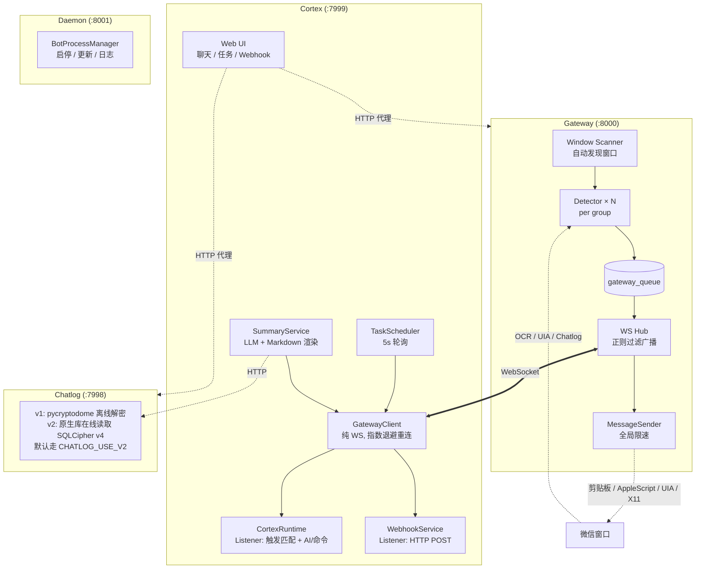

# AWSL 微信机器人

> **免责声明：本项目仅供学习交流，请勿用于商业或违规用途。使用本项目产生的任何后果由使用者自行承担。**

跨平台微信群聊机器人，采用 Gateway + Chatlog + Cortex 微服务架构。Gateway 通过 Quartz/UIAutomation/Chatlog+X11 与微信窗口交互，以 WebSocket 协议广播消息；Chatlog 作为独立数据层服务提供微信数据库解密/查询；Cortex 作为 WS 客户端，通过 MessageListener 模式处理 AI 回复、群聊总结、动态命令、定时任务和 Webhook 转发。

## 功能特性

- **跨平台支持**：macOS (Quartz 截图 + Vision OCR) / Windows (UI Automation) / Linux (Chatlog 读取 + X11 发送)
- **自动窗口发现**：自动扫描微信群聊窗口，动态增删检测线程
- **WebSocket 消息网关**：统一消息广播，支持正则过滤订阅
- **多群并发处理**：每群独立检测线程，全局限速发送
- **内置 Web UI**：访问 Cortex `:7999/` 即可使用聊天、定时任务、Webhook 管理（图片/文件支持点击/拖拽/Ctrl+V 粘贴）
- **Chatlog 双后端**：v1（pycryptodome 离线解密）/ v2（原生库在线读 SQLCipher v4，Windows/Linux），默认走 v2
- **富媒体渲染**：图片（V2 .dat 派生 AES + wxgf→JPEG）/ 表情包 / 语音（SILK→MP3）/ 视频缩略图 / 位置 / 名片 / appmsg；Web UI 内置 `[发呆][呲牙]` 等微信表情符 → Unicode emoji 替换
- **定时任务 / 群聊总结 / @触发 / 动态命令 / Webhook 转发**

<details>
<summary>架构设计</summary>



</details>

<details>
<summary>线程模型</summary>

| 线程 | 职责 | 阻塞安全 |
|------|------|----------|
| Gateway scan_loop | 窗口自动发现 (5s) | 独立线程 ✅ |
| Detector (per-group) | OCR/UIA/Chatlog 消息检测 | 独立线程 ✅ |
| Sender | 串行发送 + 全局限速 | 独立线程 ✅ |
| Gateway consume_loop | 队列消费 + WS 广播 | 独立线程 ✅ |
| GatewayClient | async WS 收发 + listener 分发 | **禁止阻塞** ⚠️ |
| Cortex ThreadPool(4) | AI/命令等阻塞操作 | 独立线程 ✅ |
| Webhook ThreadPool(3) | HTTP POST fire-and-forget | 独立线程 ✅ |
| Scheduler | 定时任务轮询 (5s) | 独立线程 ✅ |
| Summary worker | LLM 总结 + 渲染 + 发送 | daemon 线程 ✅ |
| Chatlog 服务 | sync def 路由 (FastAPI 线程池) | 独立进程 ✅ |

</details>

## 系统要求

- Python 3.11+
- **macOS**: macOS 10.15+，微信客户端，辅助功能权限 + 屏幕录制权限
- **Windows**: Windows 10/11，微信客户端，建议管理员身份运行
- **Linux**: Linux WeChat + X11 会话，需安装 `wmctrl`、`xdotool`、`xclip`、`xwininfo`，推荐安装 `xsel`

## 安装

```bash
cd awsl-wechat-bot

# 安装依赖（需要 uv: https://docs.astral.sh/uv/）
uv sync

cp .env.example .env  # 编辑配置
```

### Linux setup

Linux Gateway 通过 Chatlog 读取消息、通过 X11 发送消息，不使用截图/OCR。需要先启动 Linux WeChat，并保持要监听的群聊窗口打开。

```bash
# Ubuntu/Debian 示例：只安装系统工具，Python 依赖仍由 uv 管理
sudo apt-get install -y wmctrl xdotool xclip x11-utils xsel
```

`.env` 至少需要配置：

```env
CHATLOG_USE_V2=true
WECHAT_DB_INPUT_PATH=/path/to/xwechat_files/xxx/db_storage
WECHAT_DB_KEY={"contact/contact.db":"64hex","message/message_0.db":"64hex"}

LINUX_WECHAT_DISPLAY=:10
LINUX_WECHAT_XAUTHORITY=~/.Xauthority
```

`WECHAT_DB_KEY` 在 Linux 下是 per-db key JSON，key 使用相对 `db_storage` 的数据库路径；`LINUX_CHATLOG_MESSAGE_LIMIT` 和 `LINUX_CHATLOG_GROUP_CACHE_TTL` 可不填，使用默认值即可。

Linux 密钥从正在运行的 Linux WeChat 进程内存提取：

```bash
# 自动检测微信进程和 db_storage，输出可直接填到 WECHAT_DB_KEY
sudo uv run tools/extract_wx_keys_linux.py --json

# 自动检测失败时显式指定 db_storage
sudo uv run tools/extract_wx_keys_linux.py --db-dir /path/to/xwechat_files/xxx/db_storage --json
```

默认输出是 `{"contact/contact.db":"64hex","message/message_0.db":"64hex"}` 这种 flat JSON；如果写入 `.env`，整段 JSON 放到 `WECHAT_DB_KEY=` 后面即可。

## 配置

### 基础配置 (.env)

```env
# 触发关键词
TRIGGER_KEYWORD=awsl

# 机器人名称列表（@触发，JSON 数组格式）
BOT_NAMES=["机器人","小助手"]

# OpenAI API
OPENAI_API_KEY=your-api-key-here
OPENAI_BASE_URL=https://api.openai.com/v1
OPENAI_MODEL=gpt-4o-mini

# 远程命令（不配置 COMMAND_API_BASE_URL 等同关闭远程命令）
REMOTE_COMMANDS_ENABLED=true
COMMAND_API_BASE_URL=

# 服务端口
HTTP_API_PORT=8000
HTTP_API_TOKEN=your-secret-token  # 留空不启用认证
CORTEX_HTTP_PORT=7999
CHATLOG_HTTP_PORT=7998

# Chatlog 默认后端（true→v2 原生库，false→v1 pycryptodome）
CHATLOG_USE_V2=true

# Linux Gateway 通过 X11 发送、通过 Chatlog 读取消息
LINUX_WECHAT_DISPLAY=:10
LINUX_WECHAT_XAUTHORITY=~/.Xauthority
LINUX_CHATLOG_MESSAGE_LIMIT=20
LINUX_CHATLOG_GROUP_CACHE_TTL=30
```

## 运行

```bash
# 一体启动（Gateway + Chatlog + Cortex）
uv run main.py

# 独立启动
uv run -m gateway.main     # Gateway only (:8000)
uv run -m chatlog.main     # Chatlog only (:7998)
uv run -m cortex.main      # Cortex only (:7999)
uv run run_daemon.py       # Daemon (:8001)
```

### 触发方式

| 触发方式 | 示例 | 说明 |
|---------|------|------|
| 关键词+问题 | `awsl 今天天气怎么样？` | 触发 AI 回复 |
| @机器人 | `@机器人 帮我写首诗` | 触发 AI 回复 |
| 刷新命令 | `awsl refresh` / `awsl 刷新命令` | 刷新远程命令列表（未配置 `COMMAND_API_BASE_URL` 或 `REMOTE_COMMANDS_ENABLED=false` 时禁用） |
| 动态命令 | `<命令名> <参数>` | 执行远程命令（未配置 `COMMAND_API_BASE_URL` 或 `REMOTE_COMMANDS_ENABLED=false` 时禁用） |

<details>
<summary>API 文档</summary>

### Gateway (:8000)

```
GET  /api/health              # 健康检查
GET  /api/groups              # 群组列表
POST /api/send                # 发送消息/图片
WS   /ws                      # WebSocket（首条消息认证）
```

### Chatlog (:7998)

```
# v1 (pycryptodome 离线解密)
GET  /api/chatlog/v1/health
POST /api/chatlog/v1/decrypt
GET  /api/chatlog/v1/groups
GET  /api/chatlog/v1/messages
GET  /api/chatlog/v1/group-display-name
GET  /api/chatlog/v1/media

# v2 (原生库在线读 SQLCipher v4，Windows/Linux)
GET  /api/chatlog/v2/health
POST /api/chatlog/v2/decrypt       # no-op，v2 原生库直接读密文
GET  /api/chatlog/v2/groups
GET  /api/chatlog/v2/contacts
GET  /api/chatlog/v2/members
GET  /api/chatlog/v2/messages
POST /api/chatlog/v2/messages/batch
GET  /api/chatlog/v2/group-display-name
GET  /api/chatlog/v2/media

# 无版本前缀走 CHATLOG_USE_V2 配置（默认 true→v2）
GET  /api/chatlog/health 等

# 媒体: msg_type=3 image / 34 voice / 43 video thumb / 47 sticker / 49 file
GET  /api/chatlog/media?msg_type=&group=&server_id=&content=&hd=
# image/video-thumb 需 IMAGE_AES_KEY；voice 依赖 av/pilk，已随普通 uv sync 安装
# image hd=1 会尝试本机原图/高清 .dat（无后缀/_h/_W 等），wxgf/HEVC 会转 JPEG
# 转发聊天记录 type=19 内嵌图片目前不按普通 msg_type=3 暴露
# 文件 (49) 直接走 msg/file/<YYYY-MM>/<title> 明文, 带 Content-Disposition (UTF-8) 下载
# 返回原始 bytes + X-Media-Md5/Format + Cache-Control immutable + ETag
```

Chatlog v2 的 DB 读取接口会先确认微信进程仍在运行；微信未运行时返回 `503`，避免直接读取未在线的数据库。`/health` 可在微信未运行时继续返回服务状态，`/decrypt` 是 v2 no-op，不读取数据库。

> 消息响应包含 `server_id: int` 与 `server_id_str: str` 双字段，前者保留 JSON 数字合同，后者用于 JS 客户端避免 Number 精度丢失。

### Cortex (:7999)

```
# Web UI
GET  /                                # 主页（聊天 / 任务 / Webhook 三个 tab）
GET  /manifest.json                   # PWA manifest
GET  /static/*                        # 前端静态资源

# API
GET  /api/health
GET/POST/PUT/DELETE /api/tasks        # 定时任务 CRUD
GET/POST/PUT/DELETE /api/webhooks     # Webhook 管理
POST /api/summary                     # 群聊总结
GET  /api/groups                      # 群组列表（代理 Gateway）
POST /api/send                        # 发送消息（代理 Gateway）
GET  /api/chatlog/groups              # 群聊列表（代理 Chatlog）
GET  /api/chatlog/messages            # 查询消息（代理 Chatlog）
POST /api/chatlog/decrypt             # 解密（代理 Chatlog）
GET  /api/chatlog/health              # 无版本健康端点 + media 能力（代理 Chatlog）
GET  /api/chatlog/media               # 富媒体 bytes 透传（代理 Chatlog）
```

### Daemon (:8001)

```
GET  /status              # 运行状态
POST /start|stop|restart  # 启停控制
POST /update              # git pull + uv sync + 重启
GET  /logs?lines=100      # 日志
```

### WebSocket 协议

连接：`ws://host:8000/ws`

**Client → Server：**
```json
{"type": "auth", "token": "xxx"}
{"type": "subscribe", "group_filter": "regex", "message_filter": "regex", "priority": 0, "passive": false}
{"type": "unsubscribe"}
{"type": "send_message", "group_name": "群名", "message_type": "text", "message": "hello"}
{"type": "send_message", "group_name": "群名", "message_type": "image", "message": "<base64>"}
{"type": "send_message", "group_name": "群名", "message_type": "file", "message": "<base64>", "filename": "voice.mp3"}
```

**Server → Client：**
```json
{"type": "auth_ok"}
{"type": "subscribe_ok", "group_filter": "...", "message_filter": "...", "priority": 0, "passive": false}
{"type": "message", "group_name": "群名", "content": "消息内容", "timestamp": 1710000000.0}
{"type": "send_ok"}
{"type": "error", "detail": "..."}
```

认证：WS 首条消息 `{"type": "auth", "token": "xxx"}`（10s 超时断开），REST `Authorization: Bearer <HTTP_API_TOKEN>`；`/api/chatlog/*/media` 兼容 `?token=<HTTP_API_TOKEN>`

</details>

## 注意事项

- macOS 首次运行需授予辅助功能权限（发送）和屏幕录制权限（截图 OCR）
- 运行时微信群聊窗口需保持打开（弹出的独立聊天窗口）
- 窗口自动发现，无需手动选择群聊

### Windows 疑难排查

如果在 Windows 上启动后找不到窗口或无法获取消息，可能是讲述人（Narrator）未开启导致 UI Automation 无法正常工作。尝试通过注册表启用：

```powershell
# 查询讲述人状态（0=关闭，1=开启）
reg query "HKCU\SOFTWARE\Microsoft\Narrator\NoRoam" /v RunningState

# 启用讲述人
reg add "HKCU\SOFTWARE\Microsoft\Narrator\NoRoam" /v RunningState /t REG_DWORD /d 1 /f
```

也可以通过 **设置 → 轻松使用 → 讲述人** 手动开启，或按 `Win + Ctrl + Enter` 快捷键切换。

## 免责声明

**本项目仅供学习交流使用，请勿用于商业用途或任何违法违规行为。**

- 使用时请遵守微信使用条款和相关法律法规
- 开发者不对使用本项目造成的任何后果负责

## 许可证

MIT License
