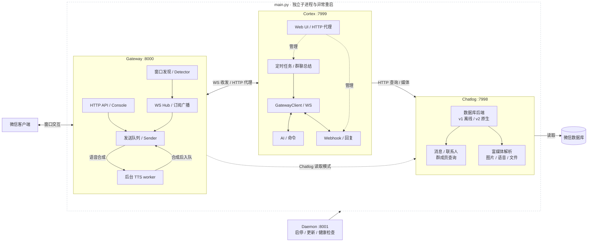

# AWSL 微信机器人

> **免责声明：本项目仅供学习交流，请勿用于商业或违规用途。使用本项目产生的任何后果由使用者自行承担。**

基于微信桌面客户端的群聊自动化机器人，支持多群消息监听、HTTP / WebSocket 收发，以及文本、图片、文件和原生语音发送；文件支持 Base64 与流式上传。

可接入 OpenAI 兼容模型，通过关键词或 @ 触发 AI 回复，提供本地/远程命令、cron 定时任务、聊天记录检索、LLM 群聊总结及 Webhook 转发与回复，配套 Web UI 管理和服务进程看护。

目前维护 Windows 和 Linux；**macOS 已停止维护，不建议使用**。

## 功能特性

- **平台适配**：Windows UIA；Linux Chatlog / AT-SPI + X11。
- **多群监听**：自动发现独立窗口，按群并发检测，全局限速发送。
- **WebSocket 网关**：正则订阅、`priority` 优先级和 `passive` 广播。
- **消息发送**：文本、图片、文件、TTS / MP3；兼容 Base64 和流式文件上传。
- **聊天记录**：v1 离线解密 / v2 原生库在线读取，支持搜索、联系人与群成员。
- **富媒体**：图片解密、HEVC 转 JPEG、SILK 转 MP3、表情与文件读取。
- **AI 与命令**：OpenAI 兼容接口、关键词 / @ 触发、本地与远程命令。
- **任务与总结**：cron 调度、LLM 群聊总结、Markdown 图片输出。
- **Web UI / Webhook**：Preact 管理界面，正则转发，文本 / JSONPath 回复。
- **运行看护**：微信登录与窗口恢复、服务进程监督、Prometheus 指标。

## 总体架构



Gateway 与微信运行在同一桌面环境，Chatlog 部署在数据库所在机器；Cortex 可独立部署。Web UI 通过 Cortex 的 HTTP 代理访问 Gateway / Chatlog；业务收发走 WS。详细组件与线程职责见 [架构文档](docs/architecture.md)。

## 快速开始

### 1. 准备平台环境

安装 **Python 3.11+**、[uv](https://docs.astral.sh/uv/) 和微信客户端，完成下列平台准备并登录微信：

| 平台 | 要求 |
| --- | --- |
| macOS | **停止维护，不建议使用**；历史实现依赖辅助功能与屏幕录制权限，不支持语音发送 |
| Windows | Windows 10/11，微信与 Bot 运行在同一交互式桌面；语音需 VB-CABLE |
| Linux | 微信、Bot 使用同一用户与 X11 会话；安装系统工具并配置 Chatlog v2 或 AT-SPI |

Windows 语音、Linux 依赖和数据库密钥配置见 [平台配置](docs/platform-setup.md)。

### 2. 安装项目

```bash
git clone https://github.com/awsl-project/awsl-wechat-bot.git
cd awsl-wechat-bot
uv sync
cp .env.example .env
```

### 3. 配置 `.env`

**启动前先编辑 `.env`，替换示例占位值。** AI 回复至少需要填写 API Key、接口地址与模型；`BOT_NAMES` 用于匹配 `@机器人`：

```dotenv
HTTP_API_TOKEN=replace-with-your-token
OPENAI_API_KEY=replace-with-your-api-key
OPENAI_BASE_URL=https://api.openai.com/v1
OPENAI_MODEL=gpt-4o-mini
BOT_NAMES=["机器人"]
```

| 功能 | 还需配置 |
| --- | --- |
| 聊天记录 / 群聊总结 | `WECHAT_DB_INPUT_PATH`、`WECHAT_DB_KEY`；Windows 密钥为 64 个十六进制字符，Linux 为 per-db key JSON。总结还需将 `BROWSER_EXECUTABLE` 设为浏览器可执行文件路径。见 [密钥提取](docs/wechat-db-key-extraction.md) |
| Linux 默认消息读取 | 配好 Chatlog v2，并设置与微信桌面一致的 `LINUX_WECHAT_DISPLAY` / `LINUX_WECHAT_XAUTHORITY`；AT-SPI 方案见 [平台配置](docs/platform-setup.md#linux-setup) |
| 语音发送 | 按平台配置 VB-CABLE / PulseAudio；使用 EdgeTTS 时清空 `LOCALAI_TTS_API_URL`，见 [语音配置](docs/platform-setup.md#windows-语音发送) |

仅使用消息发送 API 可不配置 AI。Chatlog v2 仅支持 Windows/Linux；使用 v1 时设 `CHATLOG_USE_V2=false`，并配置 `WECHAT_DB_OUTPUT_PATH`。所有选项见 [.env.example](.env.example)，参数说明见 [配置与运行](docs/configuration.md)。

### 4. 启动与验证

```bash
uv run main.py
```

访问 **http://localhost:7999/** 打开 Web UI。保持要监听的群聊独立窗口打开，Gateway 会自动发现窗口；在群内发送 `awsl 你好` 或 `@机器人 你好` 可触发 AI 回复（需先配置 AI 与机器人名称）。

## 服务入口

| 服务 | 默认端口 | 用途 |
| --- | --- | --- |
| Cortex | 7999 | Web UI、AI、命令、定时任务、总结与 Webhook |
| Gateway | 8000 | 微信交互、HTTP 发送与 WebSocket 广播 |
| Chatlog | 7998 | 聊天记录、联系人、群成员与媒体查询 |
| Daemon | 8001 | Bot 启停、更新与日志 |

`main.py` 为 Gateway、Chatlog、Cortex 提供独立子进程与异常重启。需要远程启停和更新时运行 `uv run run_daemon.py`；独立服务启动命令见 [配置与运行](docs/configuration.md#运行)。

## 文档

| 文档 | 内容 |
| --- | --- |
| [配置与运行](docs/configuration.md) | `.env`、独立启动、触发方式、远程命令白名单 |
| [平台配置](docs/platform-setup.md) | Windows 语音、Linux 安装、消息读取方式与疑难排查 |
| [微信启动与窗口恢复](docs/wechat-startup.md) | 登录看护、窗口缓存、恢复限制与状态 API |
| [开机启动部署](docs/boot-autostart.md) | Linux systemd / 桌面、Windows 登录与 Daemon 自启 |
| [API 与监控](docs/api.md) | HTTP、流式上传、WebSocket、认证、Prometheus |
| [架构与线程模型](docs/architecture.md) | 服务关系、消息流与线程职责 |
| [数据库密钥提取](docs/wechat-db-key-extraction.md) | Windows / Linux 数据库密钥与图片密钥 |
| [原生库来源](chatlog/vendor/UPSTREAM.md) | Chatlog 二进制版本、构建来源与哈希 |
| [前端开发](cortex/templates/README.md) | 无构建前端的组件结构与回归验证 |
| [测试说明](tests/README.md) | 按服务运行 unittest 与前端检查 |

## 免责声明与许可

本项目仅供学习交流，请勿用于商业或违法违规用途。使用时请遵守微信使用条款及相关法律法规；使用后果由使用者自行承担，开发者不承担责任。

MIT License
